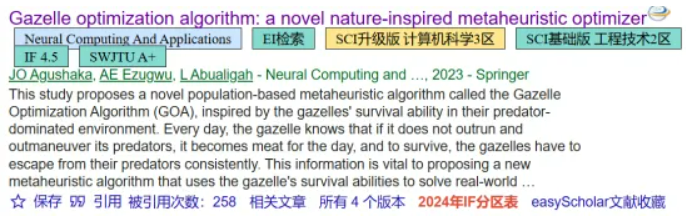
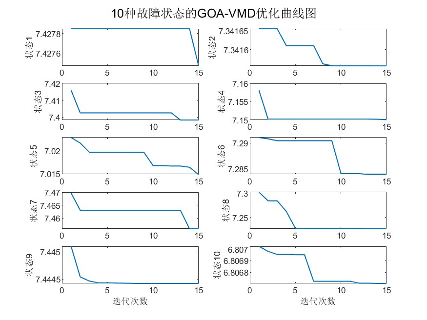
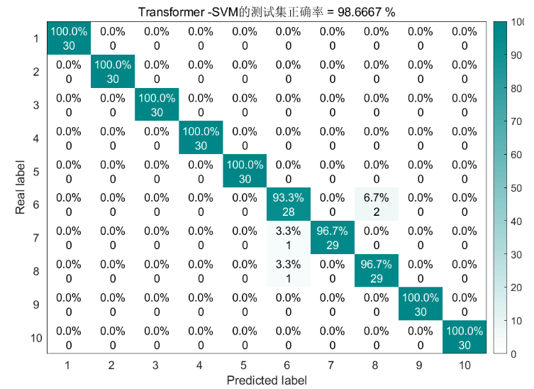
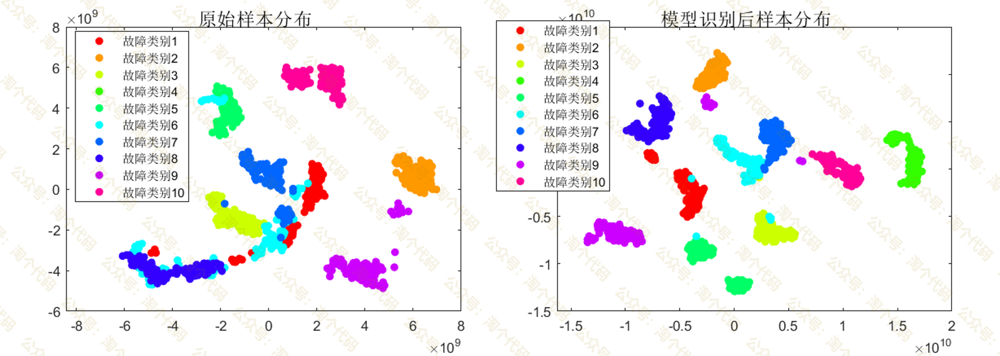
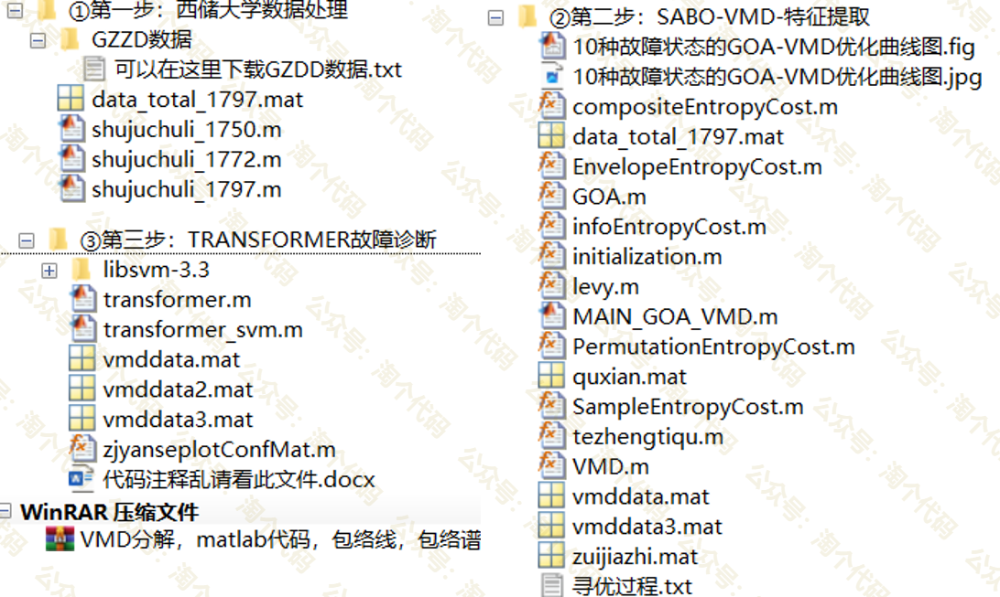

# Advanced Algorithms for GOA Optimization of VMD, Integrating Transformer-SVM for Bear Diagnosis: A Comprehensive Tutorial!

Therefore, the work includes Transformers, so it must be run on versions 2023b and above!
MATLAB2024a Quark link: https://pan.quark.cn/s/5814b1c0497c
This issue employs the 2023 Dingling Ant Optimization algorithm to optimize VMD, and combines it with Transformer-SVM for bearing diagnosis, which can be considered a minor innovation method. Those in need of a paper should hurry up!
The gazelle optimization algorithm has been previously recommended. This achievement was published in the SCI journal "Neural Computing and Applications" in 2023, a three-tier category in the field of computer science. The GOA method possesses excellent robustness and efficiency, currently cited 258 times.
\n        \n  
The following is the bearing diagnosis approach for this period:
1. Process the official downloaded data from Western Reserve University to categorize into 10 types of faults.
②Extract features from the data obtained in the first step, mainly using the GOA algorithm to optimize two parameters of VMD (modal components and penalty factors), and then back-extracting 10 state feature vectors with the optimized best values.
③ Utilize the Transformer model to learn features extracted, and replace the traditional softmax classifier with an SVM classifier to further enhance the model's classification capabilities.
Content details
1. Data Processing
Process the data from West Virginia University, which is officially downloaded, as follows:
Load a total of 10 data sets, then select the DE_time (%DE is driver-side data, FE is fan-side data, and BA is acceleration data) for each data set.
Set the sliding window w, the number of faulty sample points s for each data point, and the sample size m for each fault type.
After all the data sliding windows are completed, consolidate them into a single data variable.
Regarding the processing of data from Xichu University, there was a previous article that discussed it. You can refer to this article: "Data Processing for Bearing Diagnosis at Xichu University - Free MATLAB Code" 
The final data obtained is a matrix of size 1000*2048, where 1000 represents the sample size and 2048 denotes the number of features. This equals 1000 divided by 10, meaning there are 10 types of fault states, with each state having 100 samples. The code file is named data_total_1797.mat.

II. Feature Extraction

For the first step of data processing, feature extraction was performed on the data obtained:

The specific principles of feature extraction were also detailed in an article, which you can refer to for further reading. In essence, it involves using the criterion of minimum envelop entropy to extract the optimal IMF component from each sample, followed by calculating nine indicators for each sample: mean, variance, peak, kurtosis, effective value, peak factor, pulse factor, waveform factor, and margin factor. These nine indicators are then used to construct a feature vector for each sample.

This article utilized the Dragon Optimizer (GOA) algorithm from 2023, which optimized the VMD parameters and found the optimal IMF components for each fault type. The optimization curves for each state are also plotted in the article.

After running the program, the optimization process will be printed in the command line window as follows:
VMD optimization is being performed on data for the first fault type... Please wait patiently! The optimal VMD parameters for the first fault type data are: 2041, with the best IMF component being: IMF6. The VMD optimization for the data of the second fault type is currently being conducted... Please wait patiently! The optimal VMD parameters for the second fault type data are: 626, with the best IMF component being: IMF2. The VMD optimization for the data of the third fault type is currently being conducted... Please wait patiently! The optimal VMD parameters for the third fault type data are: 114, with the best IMF components being: IMF3. The VMD optimization for the fourth fault type data is currently being conducted... Please wait patiently! The optimal VMD parameters for the fourth fault type data are: 192, with the best IMF components being: IMF3. The optimal VMD parameters for the fifth fault type data are: 427, with the best IMF components being: IMF3. The VMD optimization for the data of the sixth fault type is currently being conducted... Please wait patiently! The optimal VMD parameters for the sixth fault type data are: 242, with 10 best IMF components being: IMF10. The VMD optimization for the data of the seventh fault type is currently being conducted... Please wait patiently! The optimal VMD parameters for the seventh fault type data are: 256, with 10 best IMF components being: IMF6. The VMD optimization for the data of the eighth fault type is currently being conducted... Please wait patiently! The optimal VMD parameters for the 8th fault type data are: 510, with the best IMF components being: IMF8. The VMD optimization for the data of the 9th fault type is currently being conducted... Please wait patiently! The optimal VMD parameters for the 9th fault type data are: 218, with the best IMF components being: IMF3. The optimal VMD parameters for the 10th fault type data are: 820, with the best IMF component being: IMF4.
III. Implementing Fault Classification with the Transformer-SVM Model
Transformer, as an innovative neural network structure, is widely popularized. By employing a Transformer encoder to mine the complex relationships between data features and the long-short term dependencies in time series, and replacing the traditional softmax classifier with an SVM classifier at the final classification stage, the model's classification accuracy has been further enhanced!
The selected SVM from this paper is downloaded from the official website in the libsvm-3.3 version, which has been compiled and can be directly run by everyone.
After extracting the features from the second step (3:1) and splitting them into training and testing sets, they were fed into the Transformer-SVM model for training. The results are as follows:
Results Display
\n        \n
Furthermore, sample distribution plots before and after recognition using the Transformer model were also drawn. After dimensionality reduction using t-SNE, a two-dimensional plane plot was created as follows:
\n        \n
Code Directory:
\n        \n
This code has been integrated into the entire family of fault diagnosis tools.
Fault Diagnosis Family Kit Download Link:

## Images

<!-- PAYMENT_BLOCK -->

## Get this dataset

- Payment link (Stripe): [Buy now](https://buy.stripe.com/3cs8yP7sY87d0vu9AB)
- Payment QR code: 

<!-- /PAYMENT_BLOCK -->
